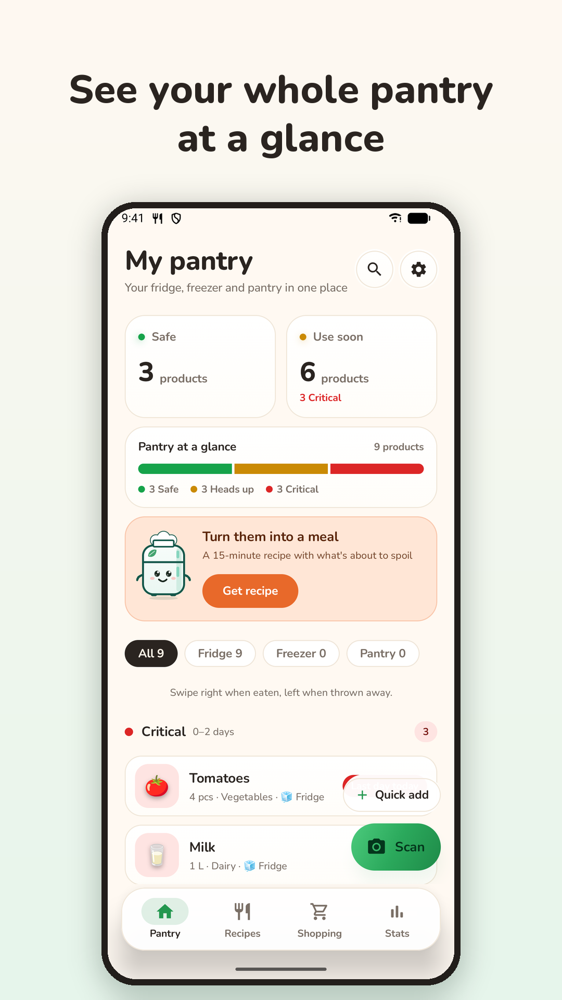
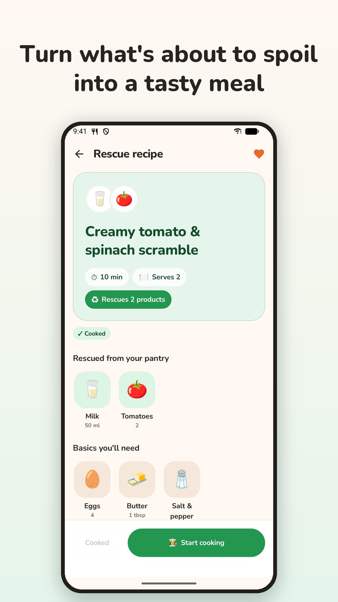
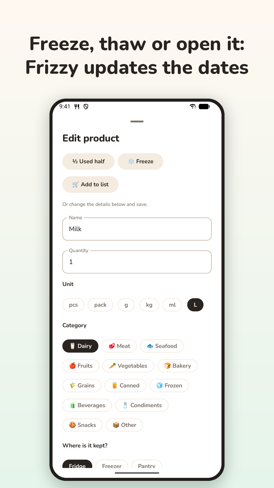
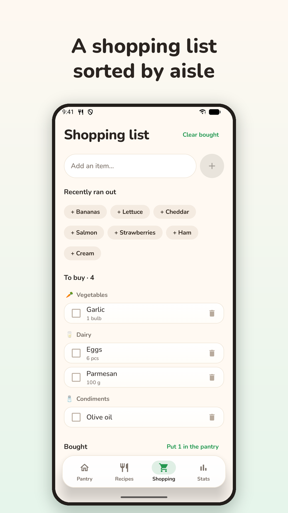

# Frizzy — Smart Pantry & Recipes

🇬🇧 English · 🇹🇷 [Türkçe](README.tr.md)

Frizzy is an Android app that helps you eat what you buy instead of throwing it away. Snap your
fridge, a shelf or a receipt and the items are added with their use-by dates; Frizzy, the fridge
mascot, reminds you before food spoils and turns what's about to go off into quick, real recipes.

<p>
  
  
  
  
</p>

> The repository and code packages are still named *Shelfie*, the app's working title. The
> Play listing is `com.nurdanpehlivan.shelfie`; users only ever see **Frizzy**.

## Features

- **Add by photo, barcode or hand.** Gemini lists the food in a photo of a fridge, shelf or
  receipt with estimated shelf life and flags items that look spoiled or expired. Printed dates
  are read on the device (ML Kit); barcodes are looked up on Open Food Facts.
- **Freshness at a glance.** A green/amber/red bar, filters by fridge, freezer and pantry, a
  daily reminder for food on its last day and a home-screen widget.
- **Freeze, thaw, "I opened it", use half.** Dates follow what you do, with undo.
- **Rescue recipes.** Quick recipes from what's about to spoil or from products you pick,
  step-by-step cooking mode with timers, links to videos and recipe sites, leftovers back to
  the pantry, recipe history and favourites.
- **Weekly meal plan and shopping list** sorted by aisle; bought items go straight to the pantry.
- **Family sharing.** One pantry, list, plan and recipe history per household, joined with an
  invite link that carries the code through the Play install.
- **Statistics.** Eaten vs. thrown away, estimated savings in your currency.
- **Five languages** (EN, TR, DE, ES, FR) with an in-app picker; item names and saved recipes
  are translated to the chosen language and cached.
- **Optional account** with sync to other phones and a web panel. Without one, data stays on
  the phone.
- **Frizzy Premium** (Google Play Billing): 50 AI scans and recipes a day instead of 3 and
  households of up to 6 instead of 2, verified on the server.

## Architecture

MVVM with clean layers, split into Gradle modules: `core:domain` (pure Kotlin), `core:data`,
`core:ui`, one module per feature and the `app` shell, with shared build setup in
`build-logic`. See [ARCHITECTURE.md](ARCHITECTURE.md).

**Stack:** Kotlin, Jetpack Compose (Material 3), Hilt, Room, DataStore, WorkManager, Retrofit +
kotlinx.serialization, Coil, Glance, ML Kit, Play Billing, Play Install Referrer.

**Backend:** a Cloudflare Worker with a D1 database in [`backend/`](backend/README.md). It
proxies Gemini (the API key never ships in the app), handles accounts, sync, households,
daily AI allowances and Play subscription checks, and serves the web panel, privacy policy and
invite pages.

## Building

Requirements: Android Studio with JDK 21, Android SDK 36.

1. Create `local.properties` in the project root (it is git-ignored):

   ```properties
   sdk.dir=C\:\\Users\\you\\AppData\\Local\\Android\\Sdk
   SHELFIE_PROXY_URL=https://your-worker.workers.dev/
   SHELFIE_PROXY_TOKEN=the APP_TOKEN secret of your Worker
   # Optional: GEMINI_MODEL=..., GEMINI_FALLBACK_MODELS=...
   ```

2. Put the Firebase config in `app/google-services.json` (Firebase console → Project settings →
   Your apps → Android; also git-ignored). It is needed for the household push messages.

3. Run the `app` configuration, or `./gradlew :app:assembleDebug`.

Debug builds can be filled with demo data from adb:

```sh
adb shell am broadcast -n com.nurdanpehlivan.shelfie/com.shelfie.app.debug.SeedDemoDataReceiver
adb shell am broadcast -n com.nurdanpehlivan.shelfie/com.shelfie.app.debug.SeedDemoDataReceiver --es lang tr
```

### Release

Release builds are signed when a git-ignored `keystore.properties` exists in the project root:

```properties
storeFile=C:/path/to/upload-key.jks
storePassword=...
keyAlias=...
keyPassword=...
```

Otherwise use *Build → Generate Signed App Bundle*. Raise `versionCode` in
`app/build.gradle.kts` for every upload to Play.

## Tests

```sh
./gradlew testDebugUnitTest :core:domain:test      # unit tests
./gradlew :core:data:connectedDebugAndroidTest      # Room migrations and sync, on an emulator
```

## Store listing

`store-assets/` holds the Play Store icon, feature graphics and screenshots (`tr/`, `en/`) and
[`listing-texts.md`](store-assets/listing-texts.md) with the name and descriptions in five
languages.

## Privacy

Privacy policy: <https://shelfie-gemini-proxy.shelfie-app.workers.dev/privacy>

## License

All rights reserved; this is not open source. See [LICENSE](LICENSE).
