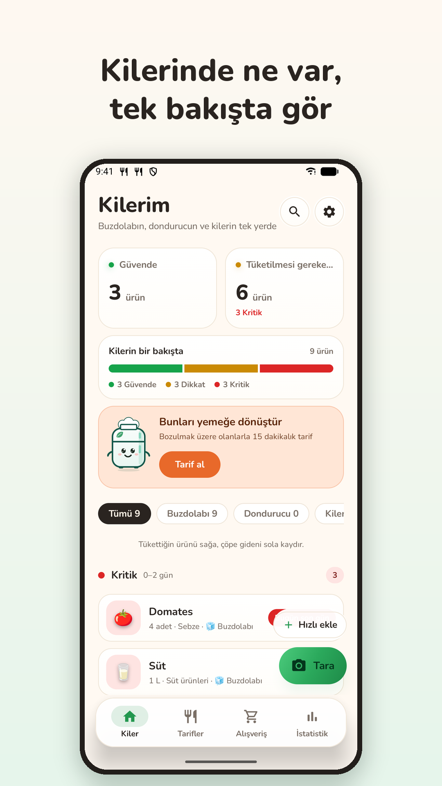
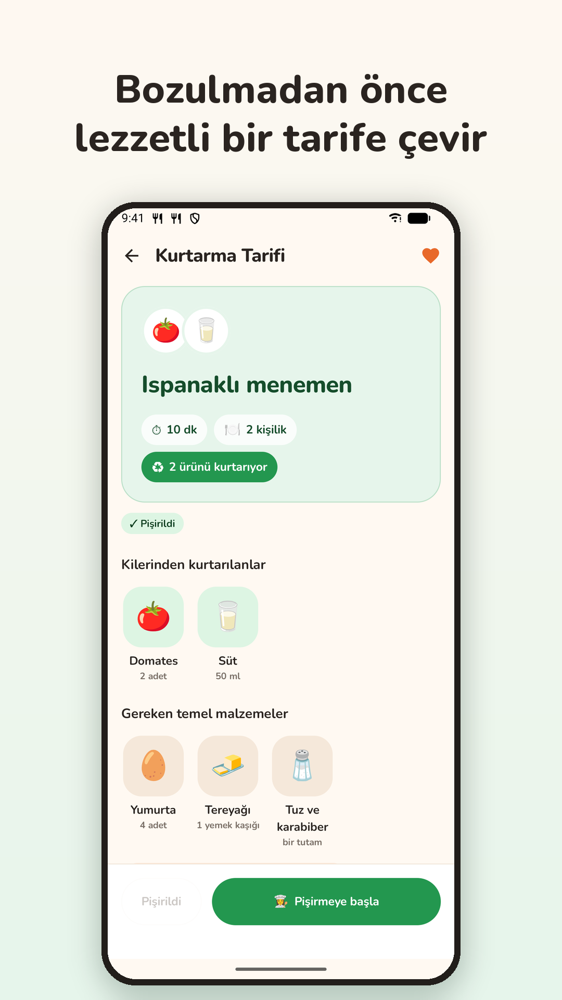
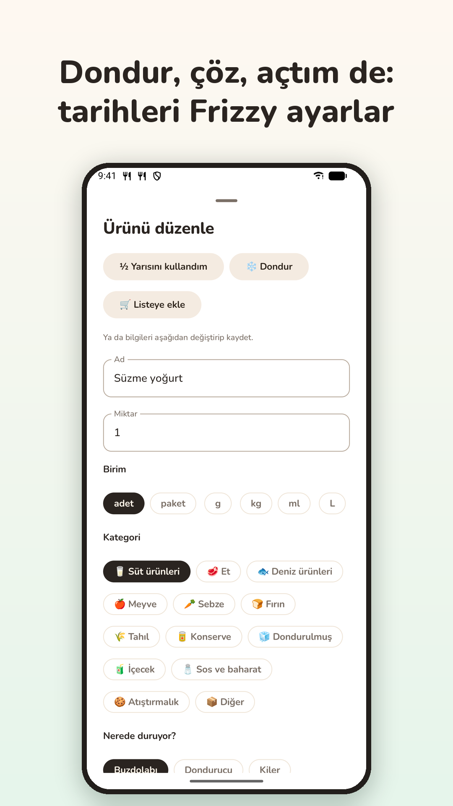
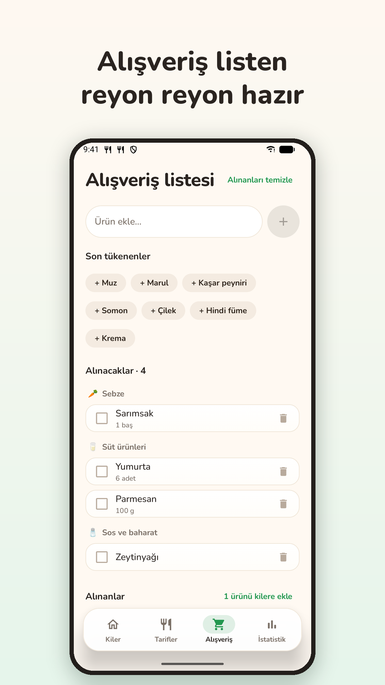

# Frizzy — Akıllı Kiler ve Tarif

🇬🇧 [English](README.md) · 🇹🇷 Türkçe

Frizzy, aldıklarını çöpe atmak yerine yemene yardım eden bir Android uygulaması. Buzdolabının,
rafının ya da market fişinin fotoğrafını çek; ürünler son kullanma tarihleriyle eklensin.
Buzdolabı maskotumuz Frizzy, yiyecekler bozulmadan seni uyarır ve bozulmak üzere olanları hızlı,
gerçek tariflere dönüştürür.

<p>
  
  
  
  
</p>

> Depo ve koddaki paketler hâlâ uygulamanın çalışma adı olan *Shelfie* adını taşıyor. Play'deki
> paket adı `com.nurdanpehlivan.shelfie`; kullanıcılar her yerde **Frizzy** görür.

## Özellikler

- **Fotoğraf, barkod ya da elle ekleme.** Gemini; buzdolabı, raf ya da fiş fotoğrafındaki
  yiyecekleri tahmini raf ömrüyle listeler, bozulmuş ya da tarihi geçmiş görünenleri işaretler.
  Paketteki tarih telefonda (ML Kit) okunur; barkodlar Open Food Facts'te aranır.
- **Tazelik tek bakışta.** Yeşil-sarı-kırmızı çubuk; buzdolabı, dondurucu ve kiler filtreleri;
  son günü gelenler için günlük hatırlatma ve ana ekran widget'ı.
- **Dondur, çöz, "açtım", yarısını kullandım.** Tarihler yaptığın işe göre güncellenir; geri
  alınabilir.
- **Kurtarma tarifleri.** Bozulmak üzere olan ya da seçtiğin ürünlerle hızlı tarifler,
  zamanlayıcılı adım adım pişirme, video ve tarif sitelerine bağlantı, artanları kilere geri
  kaydetme, tarif geçmişi ve favoriler.
- **Haftalık plan ve reyonlara göre alışveriş listesi;** alınanlar doğrudan kilere geçer.
- **Aile paylaşımı.** Hane başına tek kiler, liste, plan ve tarif geçmişi; davet kodu, Play
  kurulumu üzerinden linkle taşınır.
- **İstatistikler.** Tüketilen ve çöpe giden, kendi para biriminde tahmini tasarruf.
- **Beş dil** (TR, EN, DE, ES, FR) ve uygulama içi dil seçici; ürün adları ve kayıtlı tarifler
  seçilen dile çevrilip saklanır.
- **İsteğe bağlı hesap:** diğer telefonlarla ve web panelle senkron. Hesap yoksa veriler
  telefonda kalır.
- **Frizzy Premium** (Google Play Faturalandırma): günde 3 yerine 50 yapay zekâ taraması ve tarif,
  2 yerine 6 kişiye kadar hane; sunucuda doğrulanır.

## Mimari

Temiz katmanlı MVVM, Gradle modüllerine bölünmüş: `core:domain` (saf Kotlin), `core:data`,
`core:ui`, her özellik için bir modül ve `app` kabuğu; ortak derleme ayarları `build-logic`'te.
Ayrıntılar: [ARCHITECTURE.md](ARCHITECTURE.md).

**Teknolojiler:** Kotlin, Jetpack Compose (Material 3), Hilt, Room, DataStore, WorkManager,
Retrofit + kotlinx.serialization, Coil, Glance, ML Kit, Play Billing, Play Install Referrer.

**Sunucu:** [`backend/`](backend/README.md) altında D1 veritabanlı bir Cloudflare Worker. Gemini
isteklerine aracılık eder (API anahtarı uygulamaya hiç girmez); hesapları, senkronu, haneleri,
günlük yapay zekâ haklarını ve Play abonelik doğrulamasını yönetir; web panelini, gizlilik
politikasını ve davet sayfalarını sunar.

## Derleme

Gerekenler: JDK 21 ile Android Studio, Android SDK 36.

1. Proje kökünde `local.properties` oluştur (git'e girmez):

   ```properties
   sdk.dir=C\:\\Users\\sen\\AppData\\Local\\Android\\Sdk
   SHELFIE_PROXY_URL=https://senin-worker-adresin.workers.dev/
   SHELFIE_PROXY_TOKEN=Worker'ındaki APP_TOKEN gizli anahtarı
   # İsteğe bağlı: GEMINI_MODEL=..., GEMINI_FALLBACK_MODELS=...
   ```

2. `app` yapılandırmasını çalıştır ya da `./gradlew :app:assembleDebug`.

Debug sürümü adb ile demo verisiyle doldurulabilir:

```sh
adb shell am broadcast -n com.nurdanpehlivan.shelfie/com.shelfie.app.debug.SeedDemoDataReceiver --es lang tr
```

### Yayın sürümü

Proje kökünde git'e girmeyen bir `keystore.properties` varsa release sürümleri otomatik
imzalanır:

```properties
storeFile=C:/yol/upload-key.jks
storePassword=...
keyAlias=...
keyPassword=...
```

Yoksa *Build → Generate Signed App Bundle* kullan. Play'e her yüklemede
`app/build.gradle.kts` içindeki `versionCode`'u artır.

## Testler

```sh
./gradlew testDebugUnitTest :core:domain:test      # birim testleri
./gradlew :core:data:connectedDebugAndroidTest      # Room göçleri ve senkron, emülatörde
```

## Mağaza sayfası

`store-assets/` klasöründe Play Store simgesi, tanıtım grafikleri ve ekran görüntüleri (`tr/`,
`en/`) ile beş dilde ad ve açıklamaların yer aldığı
[`listing-texts.md`](store-assets/listing-texts.md) bulunur.

## Gizlilik

Gizlilik politikası: <https://shelfie-gemini-proxy.shelfie-app.workers.dev/privacy>

## Lisans

Tüm hakları saklıdır; açık kaynak değildir. Ayrıntılar: [LICENSE](LICENSE).
